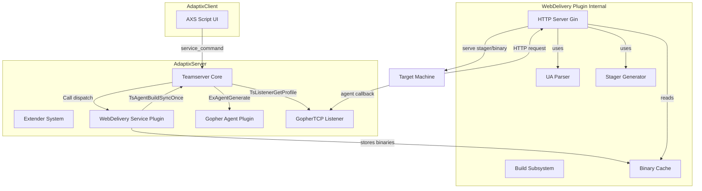

## 产品概述

AdaptixC2 Web投递插件 - 基于Gopher agent实现一键多平台自动投递上线功能

## 核心功能

- **Web投递服务**: 开启HTTP端口，提供agent二进制文件下载和stager脚本投递
- **UA自动识别**: 解析请求的User-Agent，自动判断目标操作系统和CPU架构（Windows/Linux/macOS + amd64/arm64 共6种组合）
- **Agent自动构建**: 调用服务端已有的Gopher agent构建管线，自动为所有支持平台交叉编译agent二进制
- **Stager脚本生成**: 动态生成PowerShell、Bash、Python等平台检测与执行stager，支持一句话命令复制
- **一键上线**: 目标执行一句话命令后，自动下载对应平台的agent并回连GopherTCP listener完成上线

## 技术栈

- Go语言 (plugin模式, CGO_ENABLED=1, -buildmode=plugin, 编译为.so共享库)
- Gin HTTP框架 (web投递HTTP服务器)
- adaptix PluginService接口 (Service类型插件)
- TsAgentBuildSyncOnce (复用现有Gopher agent构建管线，零代码复制)
- AXS JavaScript脚本 (客户端Qt QJSEngine UI)

## 实现方案

### 总体策略

创建一个Service类型的extender插件`webdelivery`，通过调用Teamserver已有的`TsAgentBuildSyncOnce`高级API自动构建多平台Gopher agent，并启动独立的Gin HTTP服务器提供web投递服务。关键设计决策：

1. **使用Service类型而非Listener类型**: Web Delivery不处理agent回连，而是纯粹的投递服务，Service的持久化UI面板和命令分发模式更契合
2. **复用TsAgentBuildSyncOnce而非自行复制构建逻辑**: 该API接收agent名称、配置和listener名称，内部自动调用`TsListenerGetProfile`获取listener配置，然后调用`ExAgentGenerate`完成profile生成+加密+交叉编译，返回完整二进制。避免了复制gopher_agent的AES-GCM+RC4加密、profile生成、构建流程等代码
3. **独立Gin HTTP服务器**: 不使用`TsEndpointRegisterPublic`（共享主服务端口且handler无法读取请求头），而是启动独立HTTP服务器，可完全控制UA解析和响应逻辑
4. **TsAgentBuildSyncOnce使用空builderId**: 内部`TsAgentBuildExecute("")`以同步模式执行，直接返回编译结果，无需WebSocket通信

### 工作流程

```
用户操作:
1. 创建并启动GopherTCP listener → 获得listener实例名(如"listener1")
2. 打开Web Delivery服务面板 → 填写投递端口、listener名称 → 点击"Start"
3. 插件自动构建6个平台的agent → 缓存二进制 → 启动HTTP服务器
4. 复制一句话命令(如powershell/bash) → 在目标执行

目标执行:
1. 目标执行stager → stager根据UA或运行时检测平台
2. 下载对应agent二进制 → 保存到临时目录 → 执行
3. Agent回连GopherTCP listener → 服务端注册新agent → 用户可见
```

### HTTP路由设计

| 路由 | 说明 | 返回内容 |
| --- | --- | --- |
| `/` | 自动投递 | 解析UA，返回对应stager脚本或二进制 |
| `/stage` | Stager投递 | 根据UA返回对应平台的stager脚本 |
| `/stage/ps1` | PowerShell stager | 固定返回Windows PowerShell stager |
| `/stage/sh` | Bash stager | 固定返回Linux/macOS Bash stager |
| `/stage/py` | Python stager | 固定返回Python stager |
| `/bin/<os>/<arch>` | 直接下载二进制 | 返回指定平台的agent二进制文件 |


### UA解析映射

| User-Agent特征 | 映射结果 |
| --- | --- |
| `Windows NT...Win64; x64` / `WOW64` | windows/amd64 |
| `Windows NT...ARM64` | windows/arm64 |
| `Linux...x86_64` | linux/amd64 |
| `Linux...aarch64` / `arm64` | linux/arm64 |
| `Macintosh; Intel Mac OS X` | darwin/amd64 |
| `Macintosh; ARM Mac OS X` | darwin/arm64 |
| `PowerShell/` | windows/amd64 (默认) |
| `curl/` / `wget/` (无OS信息) | 返回Bash stager(运行时检测) |
| 无法识别 | 返回通用Bash stager(运行时检测) |


### 客户端-服务端通信协议

Service插件的`Call`方法通过命令分发处理客户端请求：

| 命令 | 方向 | 说明 |
| --- | --- | --- |
| `get_config` | Client→Server | 获取当前配置 |
| `set_config` | Client→Server | 保存配置(端口、listener名等) |
| `start` | Client→Server | 启动web投递(构建agent+开HTTP) |
| `stop` | Client→Server | 停止web投递(关HTTP+清缓存) |
| `rebuild` | Client→Server | 重新构建所有平台agent |
| `status` / `build_status` | Server→Client | 服务状态/构建进度推送 |
| `commands` | Server→Client | 一句话命令更新推送 |


## 实现细节

### 性能考虑

- Agent构建为串行执行（gopher_agent的BuildPayload会写`config.go`到源码目录，并发会冲突），6个平台预计30-60秒
- 构建完成后二进制缓存在内存map中，HTTP请求直接返回bytes，无磁盘IO
- stager脚本在配置变更时重新生成，非每次请求实时生成

### 安全考虑

- 投递URL包含随机路径token（如`/x7Km9p/`），避免被扫描器发现
- 记录所有请求的IP、UA、时间到日志
- 支持可选的URL token验证（查询参数或路径段）
- stager脚本执行后清理临时文件

### 向后兼容

- 纯新增插件，不修改任何现有服务端或客户端代码
- Teamserver接口扩展仅在插件本地定义，不影响其他插件

## 架构设计



## 目录结构

```
AdaptixServer/extenders/webdelivery/             # [NEW] Web投递插件目录
├── config.yaml                                   # [NEW] 插件配置: extender_type=service, service_name=webdelivery
├── ax_config.axs                                 # [NEW] 客户端UI脚本: 配置面板、控制按钮、一句话命令显示
├── Makefile                                      # [NEW] 构建脚本: go build -buildmode=plugin → webdelivery.so
├── go.mod                                        # [NEW] Go模块: 依赖gin, axc2, msgpack
├── go.sum                                        # [NEW] 依赖校验
├── pl_main.go                                    # [NEW] 插件入口: InitPlugin, PluginService.Call命令分发(start/stop/rebuild/get_config/set_config), 生命周期管理
├── pl_server.go                                  # [NEW] Gin HTTP服务器: 路由注册, 请求处理, startServer/stopServer, UA路由分发, 二进制/stager响应
├── pl_build.go                                   # [NEW] Agent构建: buildAllPlatforms(串行调用TsAgentBuildSyncOnce构建6平台), buildStatus跟踪, 缓存管理
├── pl_stager.go                                  # [NEW] Stager生成: generatePS1Stager/generateBashStager/generatePythonStager, 动态注入投递URL和路径token
├── pl_ua.go                                      # [NEW] UA解析: ParseUserAgent→(os, arch), Windows/Linux/macOS/PowerShell/curl/wget识别, 降级策略
└── pl_types.go                                   # [NEW] 类型定义: DeliveryConfig, PlatformBinary, BuildStatus, Teamserver接口(含TsAgentBuildSyncOnce等)
```

## 关键代码结构

```
// pl_types.go - Service插件Teamserver接口定义(扩展标准Service接口)
type Teamserver interface {
    // 标准Service方法
    TsServiceReg(serviceInfo adaptix.ServiceInfo) error
    TsServiceUnreg(serviceName string) error
    TsServiceSendDataClient(operator string, service string, data string)
    TsServiceSendDataAll(service string, data string)
    TsExtenderDataSave(extenderName string, key string, value []byte) error
    TsExtenderDataLoad(extenderName string, key string) ([]byte, error)
    TsExtenderDataDelete(extenderName string, key string) error
    TsExtenderDataKeys(extenderName string) ([]string, error)
    // 扩展: Agent构建(同步模式)
    TsAgentBuildSyncOnce(agentName string, config string, listenersName []string) ([]byte, string, error)
}

// 平台二进制缓存
type PlatformKey struct { OS, Arch string }
type BinaryCache map[PlatformKey][]byte

// 投递配置
type DeliveryConfig struct {
    HostBind     string `json:"host_bind"`
    PortBind     int    `json:"port_bind"`
    ListenerName string `json:"listener_name"`  // GopherTCP listener实例名
    PathToken    string `json:"path_token"`      // URL随机路径token
    UseSSL       bool   `json:"use_ssl"`
    SslCert      []byte `json:"ssl_cert"`
    SslKey       []byte `json:"ssl_key"`
    ReconnTimeout string `json:"reconn_timeout"`
    ReconnCount   int    `json:"reconn_count"`
}
```