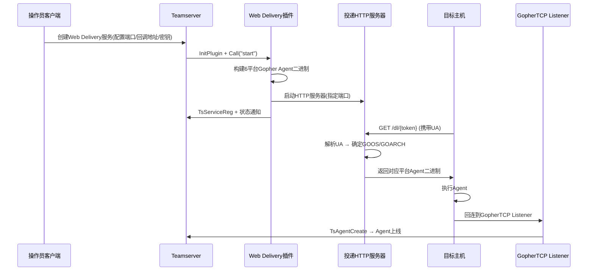

## 产品概述

为AdaptixC2框架开发Web投递（Web Delivery）插件，实现基于HTTP的自动化agent分发功能。插件通过独立端口启动HTTP服务，根据访问者的User-Agent自动识别目标操作系统和架构，投递对应平台的Gopher Agent二进制文件，实现一键上线。

## 核心功能

- **Web投递HTTP服务**：在指定端口启动HTTP服务器，提供agent二进制文件下载
- **User-Agent自动识别**：解析HTTP请求中的UA头部，自动判断目标系统（Windows/Linux/macOS）和架构（amd64/arm64），投递匹配的Gopher Agent
- **多平台Agent自动构建**：利用Gopher Agent源码进行6平台交叉编译（windows/linux/darwin × amd64/arm64），预构建并缓存所有平台二进制文件
- **一键上线命令生成**：自动生成PowerShell/Bash/Python一句话下载执行命令，方便社工投递
- **投递日志记录**：记录所有访问者的IP、UA、匹配平台、投递结果
- **与GopherTCP Listener联动**：构建的Agent自动回连到指定的GopherTCP监听器

## 技术栈

- **语言**: Go（与服务端一致）
- **HTTP框架**: Gin（与服务端一致，github.com/gin-gonic/gin）
- **插件类型**: Service类型扩展插件（.so共享库，Go plugin模式）
- **序列化**: msgpack + JSON
- **加密**: AES-GCM + RC4 overlay（与Gopher Agent一致）
- **交叉编译**: CGO_ENABLED=0 GOOS/GOARCH go build（与Gopher Agent构建方式一致）

## 实现方案

### 总体架构

Web Delivery作为Service类型插件，创建独立的Gin HTTP服务器监听指定端口。服务启动时自动为所有目标平台构建Gopher Agent二进制文件并缓存于内存/磁盘。当目标访问投递URL时，服务器解析User-Agent确定平台，返回对应的Agent二进制文件。Agent执行后自动回连到已配置的GopherTCP Listener完成上线。

### 关键技术决策

**1. 插件类型选择：Service而非Listener**

- Service插件可自主创建HTTP服务器，拥有完整的请求处理能力（包括读取UA等HTTP头部）
- 若使用`TsEndpointRegisterPublic`，handler签名为`func(body []byte) (int, []byte)`，无法读取HTTP头部，不满足UA解析需求
- Service插件可自主管理生命周期，与现有的GopherTCP Listener解耦

**2. 自建HTTP服务器而非复用主服务端口**

- 需要完整的HTTP请求处理能力（读取UA、设置Content-Type/Content-Disposition等响应头）
- 投递端口与C2主端口隔离，安全性更好，防火墙策略更灵活
- 参照BeaconHTTP Listener的实现模式，使用独立的Gin Engine + http.Server

**3. Agent源码引用策略**

- 优先查找`{ModuleDir}/src_gopher/`（插件自带副本）
- 回退查找`{ModuleDir}/../gopher_agent/src_gopher/`（同级扩展器目录）
- 构建时将源码复制到临时目录，避免修改原始文件和并发冲突

**4. UA解析策略**

- 基于正则匹配常见浏览器/工具的UA模式
- Windows: `Windows NT` + `Win64;x64`→amd64 / `ARM64`/`WOW64`→arm64
- Linux: `Linux` + `x86_64`→amd64 / `aarch64`→arm64
- macOS: `Macintosh` + `Intel`→amd64 / `ARM`→arm64
- 无法识别时默认返回windows/amd64（最常见目标）

### 数据流



## 实现要点

### 性能考虑

- **预构建缓存**：服务启动时一次性构建所有平台Agent并缓存，避免运行时编译延迟（单次约30-60秒）
- **二进制内存缓存**：使用`sync.Map`或`map`+`sync.RWMutex`缓存构建产物，投递时零延迟响应
- **构建并发控制**：6个平台可并行构建，但需限制并发数（建议2-3个），避免服务器资源耗尽

### 安全考虑

- 投递URL包含随机token（如`/dl/a8f3b2c1`），防止未授权访问
- 支持TLS加密传输
- 投递日志不记录敏感配置信息
- 服务停止时清理所有缓存的二进制文件

### 兼容性

- Windows Agent的`-H=windowsgui` ldflag需保留（无窗口运行）
- Win7支持可选（需服务器安装go-win7）
- 伪签名和图标嵌入可选（简化构建流程）

## 目录结构

```
AdaptixServer/extenders/web_delivery/          # [NEW] Web Delivery插件目录
├── config.yaml                                 # [NEW] 插件描述：extender_type: "service", service_name: "web_delivery"
├── ax_config.axs                               # [NEW] 客户端UI脚本：配置面板、状态显示、投递日志、一键命令
├── go.mod                                      # [NEW] Go模块定义
├── go.sum                                      # [NEW] 依赖校验
├── Makefile                                    # [NEW] 构建脚本：编译为web_delivery.so
├── pl_main.go                                  # [NEW] 插件入口：InitPlugin, PluginService, Call方法分发, 配置管理
├── pl_server.go                                # [NEW] HTTP服务器：Gin引擎, 投递handler, 一句话handler, 访问日志
├── pl_builder.go                               # [NEW] Agent构建器：多平台交叉编译, profile生成加密, 二进制缓存
├── pl_ua.go                                    # [NEW] UA解析：正则匹配, GOOS/GOARCH映射, 默认回退
└── pl_crypto.go                                # [NEW] 加密工具：AES-GCM+RC4 overlay, Profile加密（与Gopher Agent一致）
```

### 文件详细说明

**config.yaml** — 插件描述文件

- `extender_type: "service"`，`service_name: "web_delivery"`
- `ax_file: "ax_config.axs"`，`extender_file: "web_delivery.so"`

**pl_main.go** — 插件核心入口

- `InitPlugin(ts, moduleDir, serviceConfig)` → 返回 `PluginService`
- `Call(operator, function, args)` 方法分发：start/stop/status/get_config/set_config/get_logs/get_oneliners
- `DeliveryConfig` 结构体：HostBind, PortBind, DeliveryToken, CallbackAddresses, EncryptKey, TLS配置, 目标平台选择
- 使用 `TsExtenderDataSave/Load` 持久化配置
- Teamserver接口定义：TsServiceReg/Unreg, TsServiceSendDataClient/All, TsExtenderDataSave/Load/Delete/Keys

**pl_server.go** — HTTP投递服务器

- `DeliveryServer` 结构体：Gin Engine, http.Server, 二进制缓存map, 访问日志, 运行状态
- `StartServer()`: 创建Gin引擎，注册路由，启动HTTP/HTTPS服务
- 路由设计：
- `GET /dl/:token` — 主投递端点，解析UA，返回对应Agent二进制
- `GET /ps/:token` — 返回PowerShell一句话脚本
- `GET /sh/:token` — 返回Bash一句话脚本
- `GET /py/:token` — 返回Python一句话脚本
- `handleDelivery()`: 读取UA → 解析平台 → 查找缓存 → 设置响应头(Content-Type, Content-Disposition) → 返回二进制
- `handleOneLiner()`: 生成下载并执行Agent的脚本
- `StopServer()`: 优雅关闭，清理缓存

**pl_builder.go** — 多平台Agent构建器

- `BuildAllPlatforms(config)`: 并行构建所有启用平台的Agent
- `BuildSinglePlatform(goos, goarch, config)`: 单平台构建流程

1. 查找Gopher Agent源码目录
2. 复制源码到临时目录
3. 生成加密Profile（调用pl_crypto.go）
4. 写入config.go（嵌入encProfiles）
5. 执行交叉编译：`CGO_ENABLED=0 GOOS=... GOARCH=... go build -trimpath -ldflags="-s -w -H=windowsgui"`
6. 读取输出二进制，缓存到map

- `findGopherSource()`: 查找src_gopher目录
- `PlatformBinaries` 缓存结构：`map[string][]byte`，key为`"windows/amd64"`格式

**pl_ua.go** — User-Agent解析

- `ParseUserAgent(ua string) (goos, goarch string)`: 解析UA返回GOOS/GOARCH
- 预编译正则：Windows/Linux/macOS模式匹配
- `platformFromUA()`: 优先精确匹配，回退到默认(windows/amd64)
- 支持的UA模式列表（可扩展）

**pl_crypto.go** — 加密工具函数

- `GenerateEncryptedProfile(callbackAddrs, encryptKey, watermark, timeout, count)`: 生成加密的Agent Profile
- 构建Profile结构体(Address, BannerSize, ConnTimeout等)
- msgpack序列化
- GopherSessionEncrypt加密
- 前置加密密钥
- 格式化为`\xNN`字符串
- `GopherSessionEncrypt/GopherSessionDecrypt`: AES-GCM + RC4 overlay加密（从gopher_agent/session_crypto.go移植）
- `DeriveSubkey`, `RC4Overlay`, `TransportOverlay`: 辅助函数

**ax_config.axs** — 客户端UI脚本（JavaScript/QJSEngine）

- `metadata`: `{name: "Web Delivery", description: "..."}`
- `InitService()`: 创建配置面板
- 网络配置：HostBind(combo), PortBind(spin), TLS(check), 证书选择
- GopherTCP配置：CallbackAddresses(textmulti), EncryptKey(textline+Generate按钮)
- 目标平台选择：6个check（windows/amd64, windows/arm64, linux/amd64, linux/arm64, darwin/amd64, darwin/arm64）
- 操作按钮：Start/Stop, 生成Token
- 投递URL显示 + 复制按钮
- 一句话命令显示（PowerShell/Bash/Python tab）+ 复制按钮
- 访问日志表格（时间, IP, UA, 匹配平台, 状态）
- `data_handler(data)`: 处理服务端推送（状态更新, 日志追加, 构建进度）
- 通过 `ax.service_command("web_delivery", function, args)` 与服务端通信

**Makefile** — 构建脚本

- 目标：`web_delivery.so`
- 编译命令：`CGO_ENABLED=1 go build -buildmode=plugin -o web_delivery.so`
- 可选：复制gopher_agent/src_gopher到本目录
- clean目标